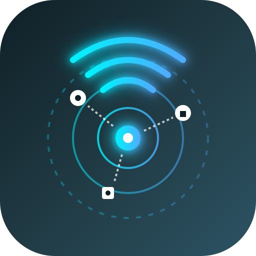
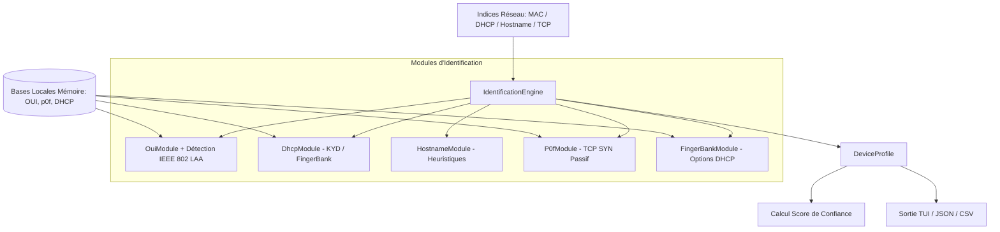

<div align="center">



# MyZone  

**Moteur passif ultra-rapide d'identification et de fingerprinting réseau d'appareils (C++17)**

[](https://github.com/VISCHENZISCH/MyZone/actions/workflows/ci.yml)
[](https://en.cppreference.com/w/cpp/17)
[](CHANGELOG.md)
[](#licence)
[](#)
[](#utilisation-en-ligne-de-commande-cli)
[](CONTRIBUTING.md)

</div>

---

**MyZone** est un moteur d'audit passif et d'identification de périphériques réseau haute performance écrit en **C++17**. Il croise instantanément plusieurs sources de signatures (IEEE OUI, Wireshark manuf, Nmap OS/Service DB, KYD FingerBank, p0f TCP SYN) pour déterminer avec précision le **fabricant**, la **catégorie**, le **système d'exploitation**, le **modèle** et le **score de confiance** de n'importe quel équipement.

> [!IMPORTANT]
> **100 % passif et furtif** : MyZone ne scanne pas le réseau et n'émet **aucun paquet**. Il analyse passivement les métadonnées (adresses MAC, requêtes DHCP, paquets TCP SYN passifs ou noms d'hôtes).

```text
  __  __       ____                  
 |  \/  |_   _|__  /___  _ __   ___   v1.2.0
 | |\/| | | | | / // _ \| '_ \ / _ \ 
 | |  | | |_| |/ /| (_) | | | |  __/  local network discovery & device auditor
 |_|  |_|\__, /____\___/|_| |_|\___|  https://github.com/VISCHENZISCH/MyZone
         |___/                       
=============================================================================
```

---

## Pourquoi MyZone ? (Comparatif)

| Fonctionnalité | MyZone | Nmap | Wireshark | Fing CLI |
|---|:---:|:---:|:---:|:---:|
| **Approche 100% passive (Zero-Packet)** | **Oui** | Non (scan actif) |  Oui |  Non (ARP flood) |
| **Détection MAC Randomisées (LAA Bit)** |  **Oui** |  Partiel |  Manuel |  Non |
| **Score de Confiance Croisé (%)** |  **Oui** |  Non |  Non |  Non |
| **Empreintes DHCP & p0f TCP SYN** |  **Natif** |  Partiel |  Dissecteur seul |  Non |
| **Vitesse d'identification** |  **~1 µs** (+ ~120 ms de chargement des bases) |  Plusieurs s/min |  Variable |  Quelques s |
| **Sortie Scriptable (JSON & CSV)** |  **Oui** |  XML/Grep |  Tshark requis |  Limité |
| **Bibliothèque C++ réutilisable (`myzone_core`)** |  **Oui** |  Non |  Non |  Non |

---

## Fonctionnalités Majeures

- **Analyse d'adresses MAC IEEE 802 avancée** :
  - Détection automatique des **adresses MAC privées / randomisées** (iOS Private Wi-Fi, Android MAC Randomization, Windows 10/11) via le bit LAA (*Locally Administered Address*).
  - Identification des diffusions **Multicast** (bit I/G) et **Broadcast**.
- **Moteur d'Identification Multi-Sources & Corrélation** :
  - `OUI` : Fabricant et catégorie par préfixe MAC indexé en mémoire (plus de 50 000 entrées IEEE, Wireshark, Nmap).
  - `DHCP` : Modèle précis et OS par empreinte MD5 (KYD / FingerBank).
  - `Hostname` : Heuristique intelligente sur noms d'hôtes mDNS, NetBIOS et DHCP (Apple, Samsung Galaxy, Google Pixel, Windows Desktop/Laptop).
  - `p0f TCP` : Fingerprinting passif de l'OS via signature SYN TCP/IP.
  - `FingerBank` : Identification d'OS via la séquence ordonnée d'options DHCP demandées.
- **Score de Confiance Intelligent (0 à 100%)** :
  - Additionne le poids des sources ayant répondu (OUI 35, DHCP 35, FingerBank/Hostname/p0f 25) avec un bonus de +10 quand fabricant et OS sont tous deux connus. Une MAC privée (LAA) ne compte que pour 15.
  - Niveaux : `high` (≥ 80), `medium` (≥ 50), `low` (> 0).
- **Architecture Propre & Modulaire (C++17)** :
  - `myzone_core` : bibliothèque C++ statique réutilisable, installable et utilisable via `find_package(MyZone)`.
  - `MyZone` : CLI interactif et scriptable avec exports `--json` et `--csv`.
- **Suite de tests automatisée** : tests unitaires et tests de bout en bout du CLI avec `ctest`, exécutés aussi sous AddressSanitizer/UBSan en CI.

---

## Compilation & Installation

### Avec CMake (Recommandé)

```bash
# 1. Cloner le dépôt
git clone https://github.com/VISCHENZISCH/MyZone.git
cd MyZone

# 2. Configurer et compiler
mkdir -p build && cd build
cmake .. -DCMAKE_BUILD_TYPE=Release
cmake --build .

# 3. Lancer la suite de tests
ctest --output-on-failure

# 4. Installer (optionnel) : binaire, bibliothèque, en-têtes et bases dans share/myzone/data
sudo cmake --install .
```

### Options CMake

| Option | Défaut | Effet |
|---|---|---|
| `MYZONE_BUILD_TESTS` | `ON` | Compile `MyZoneTests` et enregistre les tests `ctest` |
| `MYZONE_SANITIZE` | `OFF` | Active AddressSanitizer + UndefinedBehaviorSanitizer (GCC/Clang) |

### Emplacement des bases de signatures

MyZone cherche le dossier `data/` dans cet ordre : variable d'environnement `MYZONE_DATA`, `data/` près du répertoire courant ou de l'exécutable, puis `<prefix>/share/myzone/data` après installation.

---

## Utilisation en Ligne de Commande (CLI)

### Modes Directs

```bash
# Identifier une adresse MAC standard
./MyZone --mac B8:27:EB:12:34:56

# Détecter une MAC randomisée avec nom d'hôte
./MyZone --mac DA:A1:19:12:34:56 --hostname "Galaxy-S23-Ultra"

# Export JSON pur (pipable directement dans jq)
./MyZone --mac AC:DE:48:00:11:22 --hostname "iPhone-de-Tom" --json | jq .

# Export CSV pour audits et inventaires de parcs
./MyZone --mac 00:1A:2B:00:00:00 --csv

# Identifier par empreinte DHCP MD5
./MyZone --dhcp "0123456789abcdef0123456789abcdef"
```

### Options de Ligne de Commande

| Option | Argument | Description |
|---|---|---|
| `--mac` | `<address>` | Adresse MAC de l'appareil (formats: `AA:BB:...`, `AA-BB-...`, `AABB...`) |
| `--hostname` | `<name>` | Nom d'hôte réseau (mDNS, NetBIOS, DHCP) |
| `--dhcp` | `<hash>` | Hash MD5 d'empreinte DHCP (32 caractères) |
| `--tcp` | `<signature>` | Signature TCP passive (format p0f) |
| `--dhcp-options` | `<list>` | Liste d'options DHCP (ex: `1,15,3,6,44`) |
| `--json` | *(aucun)* | Sortie JSON stricte et complète avec confiance et métadonnées |
| `--csv` | *(aucun)* | Sortie CSV tabulaire (en-tête inclus) |
| `--quiet`, `-q` | *(aucun)* | Mode silencieux (masque logs et bannières) |
| `--help`, `-h` | *(aucun)* | Affichage immédiat de l'aide |
| `--version`, `-v` | *(aucun)* | Affichage de la version |

**Codes de sortie** : `0` succès, `1` bases de signatures introuvables, `2` erreur d'utilisation (option inconnue, valeur manquante, MAC invalide, `--json` avec `--csv`, ou `--json`/`--csv` sans identifiant). Les erreurs sont écrites sur `stderr`, la sortie `stdout` reste exploitable par un script.

---

## Exemple de Sortie JSON

Les champs `category` et `confidenceLevel` sont des **identifiants stables en anglais**, destinés aux scripts. Leurs libellés traduits sont dans `categoryLabel` et `confidenceLabel`.

```bash
./MyZone --mac 00:11:22:33:44:55 --dhcp-options "1,15,3,6,44,46,47,31,33,121,249,43" --json | jq .
```

```json
{
  "mac": "00:11:22:33:44:55",
  "isRandomMac": false,
  "manufacturer": "CIMSYS Inc",
  "osName": "Microsoft Windows Vista/7 or Server 2008 (Version 6.0)",
  "dhcpOptions": "1,15,3,6,44,46,47,31,33,121,249,43",
  "confidence": 70,
  "confidenceLevel": "medium",
  "confidenceLabel": "Moyen",
  "modules": [
    {"name": "OUI", "detail": "CIMSYS Inc (Inconnu)"},
    {"name": "FingerBank", "detail": "Microsoft Windows Vista/7 or Server 2008 (Version 6.0)"}
  ]
}
```

Valeurs possibles de `category` : `Computer`, `Mobile`, `Tablet`, `Server`, `VirtualMachine`, `Modem`, `Router`, `Switch`, `AccessPoint`, `Printer`, `SmartTV`, `GamingConsole`, `Audio`, `Camera`, `SmartHome`, `Wearable`, `IoT` (absent si inconnue).

---

## Architecture Logicielle



---

## Intégration en tant que Bibliothèque C++

MyZone s'installe comme une bibliothèque statique avec sa configuration CMake :

```cmake
find_package(MyZone 1.2 REQUIRED)
target_link_libraries(mon_app PRIVATE MyZone::myzone_core)
```

```cpp
#include <iostream>
#include <memory>
#include <myzone/DataLocator.hpp>
#include <myzone/Database.hpp>
#include <myzone/IdentificationEngine.hpp>
#include <myzone/modules/HostnameModule.hpp>
#include <myzone/modules/OuiModule.hpp>

int main(int, char* argv[]) {
    const myzone::Database db(myzone::DataLocator::locate(argv[0]));
    myzone::IdentificationEngine engine;
    engine.addModule(std::make_unique<myzone::OuiModule>(db));
    engine.addModule(std::make_unique<myzone::HostnameModule>());

    myzone::DeviceProfile target;
    target.mac = myzone::MacAddress("B8:27:EB:12:34:56");

    const myzone::DeviceProfile result = engine.identify(target);
    std::cout << "Fabricant : " << result.manufacturer << "\n";
    std::cout << "Confiance : " << result.calculateConfidence() << "%\n";
    return 0;
}
```

---

## Mise à Jour Automatique des Signatures

Un script Python dédié permet d'actualiser les bases de données locales en un instant :

```bash
python3 scripts/update_signatures.py
```

---

## Roadmap

- [x] **v1.1** : détection IEEE 802 (LAA, multicast, broadcast), score de confiance, exports `--json` / `--csv`, CI multi-plateforme.
- [x] **v1.2 (actuelle)** : fiabilité. Voir le [CHANGELOG](CHANGELOG.md) : sorties machine stables, CLI stricte, bibliothèque installable, licences tierces documentées.
- [ ] **v1.3** : moteur par indices. Fusion pondérée avec détection des conflits entre sources, confiance fondée sur l'accord entre sources, vrai matcher p0f (jokers), taxonomie FingerBank, mode lot (`--input`, JSONL).
- [ ] **v2.0** : passif réel. Capture libpcap (`-i eth0`, `-r capture.pcap`), analyse DHCP / ARP / mDNS / NBNS / SSDP / TCP SYN, inventaire SQLite et suivi des MAC aléatoires.

---

##  Contribution

Les contributions sont chaleureusement accueillies ! Consultez [CONTRIBUTING.md](CONTRIBUTING.md) pour les règles de style et le processus de pull request.

---

## Licence

Le code de ce projet est sous licence **MIT**. Consultez le fichier [LICENSE](LICENSE) pour plus de détails.

Les bases de signatures du dossier `data/` restent soumises à leurs licences d'origine (GPL, NPSL, LGPL, ODbL) : voir [THIRD_PARTY_LICENSES.md](THIRD_PARTY_LICENSES.md).
