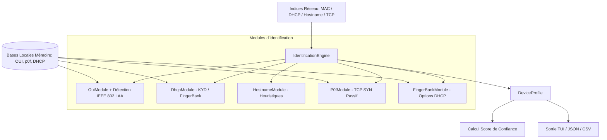

<div align="center">


# MyZone  

**Moteur passif ultra-rapide d'identification et de fingerprinting réseau d'appareils (C++17)**

[](.github/workflows/ci.yml)
[](https://en.cppreference.com/w/cpp/17)
[](#licence)
[](#)
[](#utilisation-en-ligne-de-commande-cli)
[](CONTRIBUTING.md)

</div>

---

**MyZone** est un moteur d'audit passif et d'identification de périphériques réseau haute performance écrit en **C++17**. Il croise instantanément plusieurs sources de signatures (IEEE OUI, Wireshark manuf, Nmap OS/Service DB, KYD FingerBank, p0f TCP SYN) pour déterminer avec précision le **fabricant**, la **catégorie**, le **système d'exploitation**, le **modèle** et le **score de confiance** de n'importe quel équipement.

> [!IMPORTANT]
> **100 % passif et furtif** : MyZone ne scanne pas le réseau et n'émet **aucun paquet**. Il analyse passivement les métadonnées (adresses MAC, requêtes DHCP, paquets TCP SYN passifs ou noms d'hôtes).

```text
  __  __       ____                  
 |  \/  |_   _|__  /___  _ __   ___   v1.1
 | |\/| | | | | / // _ \| '_ \ / _ \ 
 | |  | | |_| |/ /| (_) | | | |  __/  local network discovery & device auditor
 |_|  |_|\__, /____\___/|_| |_|\___|  https://github.com/VISCHENZISCH/MyZone
         |___/                       
=============================================================================
```

---

## Pourquoi MyZone ? (Comparatif)

| Fonctionnalité | MyZone | Nmap | Wireshark | Fing CLI |
|---|:---:|:---:|:---:|:---:|
| **Approche 100% passive (Zero-Packet)** | **Oui** | Non (scan actif) |  Oui |  Non (ARP flood) |
| **Détection MAC Randomisées (LAA Bit)** |  **Oui** |  Partiel |  Manuel |  Non |
| **Score de Confiance Croisé (%)** |  **Oui** |  Non |  Non |  Non |
| **Empreintes DHCP & p0f TCP SYN** |  **Natif** |  Partiel |  Dissecteur seul |  Non |
| **Vitesse d'exécution** |  **< 2 ms** |  Plusieurs s/min |  Variable |  Quelques s |
| **Sortie Scriptable (JSON & CSV)** |  **Oui** |  XML/Grep |  Tshark requis |  Limité |
| **Bibliothèque C++ réutilisable (`libmyzone`)** |  **Oui** |  Non |  Non |  Non |

---

## Fonctionnalités Majeures

- **Analyse d'adresses MAC IEEE 802 avancée** :
  - Détection automatique des **adresses MAC privées / randomisées** (iOS Private Wi-Fi, Android MAC Randomization, Windows 10/11) via le bit LAA (*Locally Administered Address*).
  - Identification des diffusions **Multicast** (bit I/G) et **Broadcast**.
- **Moteur d'Identification Multi-Sources & Corrélation** :
  - `OUI` : Fabricant et catégorie par préfixe MAC indexé en mémoire (plus de 50 000 entrées IEEE, Wireshark, Nmap).
  - `DHCP` : Modèle précis et OS par empreinte MD5 (KYD / FingerBank).
  - `Hostname` : Heuristique intelligente sur noms d'hôtes mDNS, NetBIOS et DHCP (Apple, Samsung Galaxy, Google Pixel, Windows Desktop/Laptop).
  - `p0f TCP` : Fingerprinting passif de l'OS via signature SYN TCP/IP.
  - `FingerBank` : Identification d'OS via la séquence ordonnée d'options DHCP demandées.
- **Score de Confiance Intelligent (0 à 100%)** :
  - Synthétise la fiabilité globale de l'identification grâce à des règles de corrélation croisée (ex: MAC Apple + Hostname iOS = 95% de confiance).
- **Architecture Propre & Modulaire (C++17)** :
  - `myzone_core` : bibliothèque C++ statique réutilisable pour vos propres projets.
  - `MyZone` : CLI interactif et scriptable avec exports `--json` et `--csv`.
- **Suite de tests automatisée** : tests unitaires intégrés avec `ctest`.

---

## Compilation & Installation

### Avec CMake (Recommandé)

```bash
# 1. Cloner le dépôt
git clone https://github.com/VISCHENZISCH/MyZone.git
cd MyZone

# 2. Configurer et compiler
mkdir -p build && cd build
cmake .. -DCMAKE_BUILD_TYPE=Release
cmake --build .

# 3. Lancer la suite de tests
ctest --output-on-failure

# 4. Installer (optionnel)
sudo cmake --install .
```

### Compilation rapide avec GCC / Clang

```bash
g++ -std=c++17 -O3 -DNDEBUG -Wall -Wextra -Wpedantic -Iinclude \
  main.cpp src/*.cpp src/modules/*.cpp \
  -o MyZone

./MyZone
```

---

## Utilisation en Ligne de Commande (CLI)

### Modes Directs

```bash
# Identifier une adresse MAC standard
./MyZone --mac B8:27:EB:12:34:56

# Détecter une MAC randomisée avec nom d'hôte
./MyZone --mac DA:A1:19:12:34:56 --hostname "Galaxy-S23-Ultra"

# Export JSON pur (pipable directement dans jq)
./MyZone --mac AC:DE:48:00:11:22 --hostname "iPhone-de-Tom" --json | jq .

# Export CSV pour audits et inventaires de parcs
./MyZone --mac 00:1A:2B:00:00:00 --csv

# Identifier par empreinte DHCP MD5
./MyZone --dhcp "0123456789abcdef0123456789abcdef"
```

### Options de Ligne de Commande

| Option | Argument | Description |
|---|---|---|
| `--mac` | `<address>` | Adresse MAC de l'appareil (formats: `AA:BB:...`, `AA-BB-...`, `AABB...`) |
| `--hostname` | `<name>` | Nom d'hôte réseau (mDNS, NetBIOS, DHCP) |
| `--dhcp` | `<hash>` | Hash MD5 d'empreinte DHCP (32 caractères) |
| `--tcp` | `<signature>` | Signature TCP passive (format p0f) |
| `--dhcp-options` | `<list>` | Liste d'options DHCP (ex: `1,15,3,6,44`) |
| `--json` | *(aucun)* | Sortie JSON stricte et complète avec confiance et métadonnées |
| `--csv` | *(aucun)* | Sortie CSV tabulaire (en-tête inclus) |
| `--quiet`, `-q` | *(aucun)* | Mode silencieux (masque logs et bannières) |
| `--help`, `-h` | *(aucun)* | Affichage immédiat de l'aide |
| `--version`, `-v` | *(aucun)* | Affichage de la version |

---

## Exemple de Sortie JSON

```json
{
  "mac": "AC:DE:48:00:11:22",
  "isRandomMac": false,
  "manufacturer": "Apple, Inc.",
  "category": "Mobile",
  "osName": "Apple iOS",
  "hostname": "iPhone-de-Tom",
  "confidence": 95,
  "confidenceLevel": "Élevé",
  "modules": [
    {"name": "OUI", "detail": "Apple, Inc. (Mobile)"},
    {"name": "Hostname", "detail": "Pattern iPhone détecté"}
  ]
}
```

---

## Architecture Logicielle



---

## Intégration en tant que Bibliothèque C++

MyZone peut être intégré en tant que bibliothèque statique dans vos propres applications :

```cpp
#include <myzone/IdentificationEngine.hpp>
#include <myzone/Database.hpp>
#include <myzone/modules/OuiModule.hpp>
#include <myzone/modules/HostnameModule.hpp>

int main() {
    myzone::Database db("data");
    myzone::IdentificationEngine engine;
    engine.addModule(std::make_unique<myzone::OuiModule>(db));
    engine.addModule(std::make_unique<myzone::HostnameModule>());

    myzone::DeviceProfile target;
    target.mac = myzone::MacAddress("B8:27:EB:12:34:56");
    
    myzone::DeviceProfile result = engine.identify(target);
    std::cout << "Fabricant : " << result.manufacturer << "\n";
    std::cout << "Confiance : " << result.calculateConfidence() << "%\n";
    return 0;
}
```

---

## Mise à Jour Automatique des Signatures

Un script Python dédié permet d'actualiser les bases de données locales en un instant :

```bash
python3 scripts/update_signatures.py
```

---

## Roadmap vers les 20k Étoiles

- [x] **v1.1 (Actuelle)** :
  - Détection avancée IEEE 802 (MAC Randomisées LAA, Multicast, Broadcast).
  - Moteur de score de confiance croisé (0 - 100%).
  - Découpage modulaire Clean Architecture (`DataLocator`, `CliParser`, `InteractiveCli`).
  - Exports multi-formats `--json` et `--csv`.
  - Intégration CI GitHub Actions multi-plateforme.
  - Script de synchronisation des signatures.
- [ ] **v2.0 (Prochainement)** :
  - **Mode Sniffer Passif en temps réel** (écoute live du trafic ARP, DHCP, mDNS sans émettre de paquet).
  - Support de lecture de captures PCAP (`myzone --pcap capture.pcapng`).
  - Serveur REST API local ultra-léger pour intégration dashboard web.

---

##  Contribution

Les contributions sont chaleureusement accueillies ! Consultez [CONTRIBUTING.md](CONTRIBUTING.md) pour les règles de style et le processus de pull request.

---

## Licence

Ce projet est sous licence **MIT**. Consultez le fichier [LICENSE](LICENSE) pour plus de détails.
